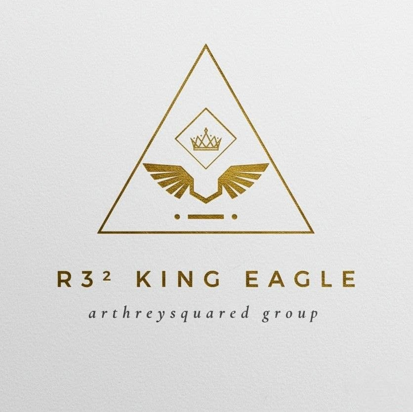

# ARTHREYSQUARED Group Starter Website

This starter project separates the company homepage from the student coursework portal.

## Files

- `index.html` — main ARTHREYSQUARED Group homepage
- `coursework.html` — student courseworks and instructor portal
- `styles.css` — all colors, layout, typography, and responsive rules
- `script.js` — mobile menu, tabs, course filters, automatic footer year

## Quick start in VS Code

1. Open the folder in Visual Studio Code.
2. Install the **Live Server** extension if you do not already have it.
3. Right-click `index.html`.
4. Choose **Open with Live Server**.

## Important edits

### 1. Company email
Search for:

`hello@arthreysquared.com`

Replace it with your actual company email after you create one.

### 2. Google Drive folders
Open `coursework.html` and replace each:

`https://drive.google.com`

with the correct course folder link.

### 3. Logo
The starter uses a CSS `A²` brand mark.

When your final logo is ready, put it in:

`assets/logo.png`

Then replace:

```html
<span class="brand-mark" aria-hidden="true">A²</span>
```

with:

```html

```

Do the same in both `index.html` and `coursework.html`.

### 4. Brand colors
Edit the variables near the top of `styles.css`:

```css
:root {
  --navy: #0b1f3a;
  --blue: #2563eb;
  --teal: #0f766e;
  --gold: #d99a24;
}
```

### 5. Product/reviewer cards
In `index.html`, edit the section with ID:

`review-materials`

Later, each card can link to:
- a product page
- a Google Form
- a checkout page
- a PDF preview
- an online course
- a store page

## Recommended future pages

As ARTHREYSQUARED grows, add:

- `tutorials.html`
- `review-center.html`
- `publishing.html`
- `catalog.html`
- `about.html`
- `contact.html`
- `privacy.html`
- `terms.html`

## Recommended company architecture

ARTHREYSQUARED Group
- ARTHREYSQUARED Learning Hub
- ARTHREYSQUARED Tutorials
- ARTHREYSQUARED Review
- ARTHREYSQUARED Publishing

This keeps the company brand broader than the founder's current teaching assignments.
